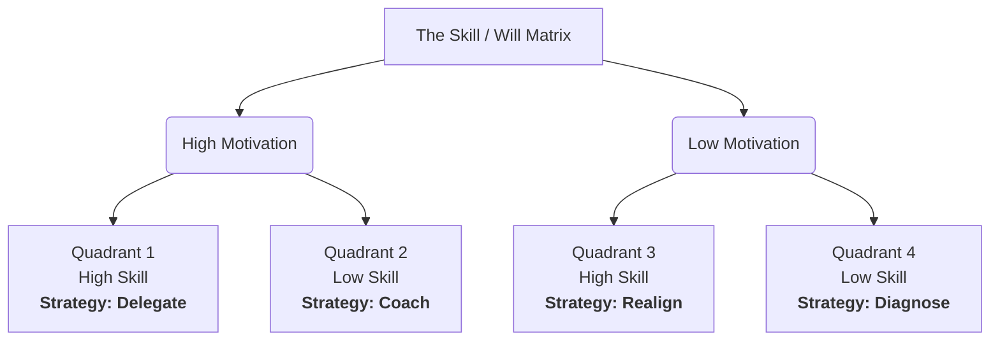

Transitioning from senior engineer to engineering manager remains one of tech's most perilous leaps. Over almost a decade of managing high-performance teams I witnessed twin extremes catching nearly every new technical leader.

Moving from individual contributor to manager requires completely rewiring how you view productivity and control. Output is no longer measured by code written. It is measured by clarity created, decisions enabled and people grown.

### Twin Traps of New Management

Engineers promoted without formal management training typically fall into one of two behavioral traps.

**Micromanagement Traps:** Engineers are accustomed to deterministic systems. You write code and it executes predictably. People are not deterministic. When new managers expect teams to write code exactly as they would write it, frustration sets in deeply. They micromanage pull requests. They hover over architecture decisions. They remain visibly angry when timelines slip.

They try controlling teams exactly how they controlled software. This instantly destroys trust and stifles innovation.

**Empathy Traps:** On opposite spectrums sit managers trying to shield teams from every hardship. If engineers struggle, empathetic managers jump into trenches absorbing overflow work.

I learned firsthand this approach does not scale. Managers acting as shields by doing work themselves inevitably burn out. They simultaneously rob engineers of friction required for professional growth.

Strategic delegation is not abdication of responsibility. It forms core effective management. But to delegate effectively you must realize engineers are not interchangeable resources.

### Implementing Skill/Will Frameworks

To abandon micromanagement and over-empathy I adopted Skill/Will matrices. This foundational concept in organizational psychology evaluates talent across two axes: capability (**Skill**) and internal motivation (**Will**).

It forces looking at each person individually. It demands choosing leadership strategies fitting their specific situation. Identical approaches cannot work for every engineer.

**Quadrant 1: High Skill, High Will**

These are highly capable and self-motivated operators. Management playbooks here are simple. Establish strategic objectives. Delegate authority. Get out of their way. Managing these engineers too closely breeds resentment.

**Quadrant 2: Low Skill, High Will**

These are often junior engineers or experienced engineers transitioning to new domains. They have drive but lack context. Strategy here requires rigorous coaching. You do not do work for them. You pair them with strong mentors. You provide tight feedback loops until capability catches up with motivation.

**Quadrant 3: High Skill, Low Will**

This is a difficult quadrant. These are veteran engineers. They remain technically brilliant but suffer from burnout or boredom. Novice managers try fixing this by lowering workload. Strategic managers first locate what drains them, then realign responsibilities to reignite drive.

### Executive Tests: Managing Quadrant 4

True tests of engineering managers lie in how they handle **Quadrant 4: Low Skill, Low Will**.

Early in my management career empathy made me avoid this quadrant. I assumed people simply needed more time or lighter workloads. Reality proves that ignoring Quadrant 4 employees destroys morale among high performers. High performers inevitably end up carrying dead weight.

Addressing this quadrant requires direct conversations. You must ask hard questions. *Are they actually a bad engineer, or are they simply a bad fit for this specific project?*

Sometimes the most empathetic action a manager can take is acknowledging an engineer sits in the wrong place. I sit down with people in this quadrant and systematically evaluate their path.

Frequently, engineers failing on fast-paced feature development teams thrive on teams focused on stabilizing legacy architecture. Problems are not always lack of ability. It is often mismatches between person and environment.

Managers posing as leaders simply fire underperformers or ignore them. Real leaders diagnose root causes. They have uncomfortable conversations. They make strategic moves placing people where they actually shine.

### Building Teams That Build Products

Management is not simply assigning tasks and attending strategy meetings. It requires diagnosing unique psychological and technical profiles of every person on your team.

Transitioning from engineer to manager requires abandoning the idea you can code your way out of problems. Your job is no longer building products directly. Your job is building teams that build products.

That shift from logic to leadership is uncomfortable. Results become less immediate and less visible. But when it works, your impact no longer ends with your own contribution. It compounds through every person you help become more capable, confident and effective.
