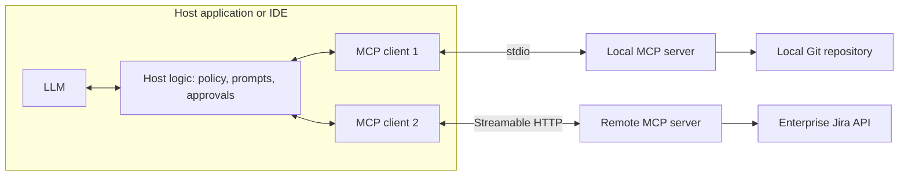
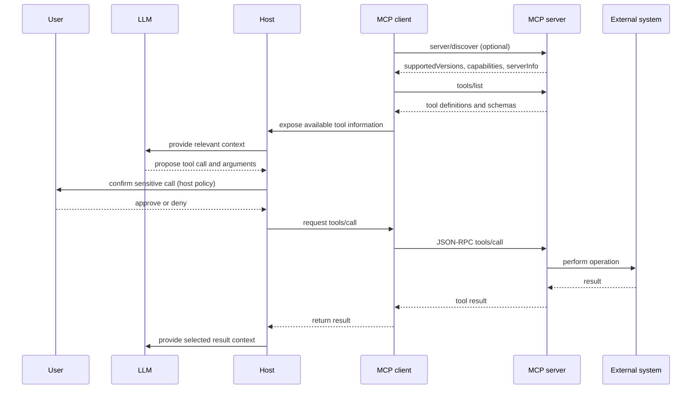

Early on, wiring a language model into external systems meant hitting a wall familiar to any systems engineer. Building an integration felt like writing a custom device driver for a single peripheral. We hardcoded REST endpoints. We scattered API credentials across wrapper scripts and built fragile prompt-handling logic just to let an agent query a local database. Each new tool demanded bespoke plumbing.

Model Context Protocol (MCP) tries to standardize that layer.

Systems engineers will recognize its shape. A JSON-RPC 2.0 boundary sits between an application hosting a model and external servers offering tools, resources or prompts, behaving like local IPC over stdio while acting as plain network RPC over Streamable HTTP.

Analogies to AIDL or gRPC help only so far. Where they break is instructive. Contracts are discovered at runtime and described with JSON Schema rather than compiled from an interface definition, and because a language model reads free-text descriptions to pick its next call, those descriptions themselves become an attack surface. No kernel vouches for caller identity. Binder supplies a UID and PID from kernel space, whereas MCP servers can ask clients for input through elicitation and mutate their tool catalogs between calls. Treat MCP as an untrusted RPC boundary, closer to a plugin API than to Binder.

MCP also says nothing about how a host builds prompts, chooses a tool or asks a person for approval. Those responsibilities stay with surrounding system architecture, right where wire protocols stop and production engineering begins.

## Topology: Host, Client and Server

MCP separates model orchestration from tool execution. Models propose actions. A host application decides what happens to each one. Inside that host, one MCP client is created per server and each speaks to a single backend.

Notice one critical property in host topology below: models never talk to clients directly. Host logic sits between them.

Hosts and clients usually ship inside one application process rather than running as independent network services, while a server is any process or remote service implementing a capability. Cardinality shifts with transport. A stdio server typically serves one client that spawned it, whereas a remote Streamable HTTP server fronts many clients at once. Every server brings its own tools, resources and operational failure modes.

MCP defines two standard transports:

* **stdio:** Clients launch servers as subprocesses and exchange newline-delimited JSON-RPC messages over standard input and output. This fits local integrations such as Git, filesystem access or embedded toolchains. Standard output carries valid MCP messages only. Diagnostics go to standard error.
* **Streamable HTTP:** Clients send messages as HTTP POST requests. Servers answer with plain JSON or open a Server-Sent Events (SSE) stream when sending multiple messages. Remote deployments rely on this transport.

Transport choice changes deployment, connection management and security requirements without changing what a `tools/call` request means. HTTP servers carry several distinct controls that are easy to blur together:

* **Origin validation:** Servers must validate `Origin` on incoming requests to defend against DNS rebinding, answering invalid ones with HTTP 403. It protects local servers from hostile web pages. It is not authentication, since non-browser clients can send any `Origin` header or none at all.
* **Loopback binding:** A server running locally should bind to `127.0.0.1` rather than every network interface.
* **Authentication:** Servers should authenticate every request to establish caller identity.
* **Authorization:** Separate and still our job. It decides what that authenticated caller may do.

Stdio deserves its own warning. A server launched over stdio inherits effective privileges of its launching process, absent sandboxing or OS restrictions. A compromised package pulled in through `npx` can read `~/.ssh` as easily as any other process running under that user account.

## Discovery as an Architecture Decision

At wire level, modern MCP is stateless. Each request carries its own protocol version, client capabilities and usually client info inside `_meta` so MCP itself demands no session affinity, yet authorization context, tenant data and long-running task state still have to live somewhere accessible to whichever server instance handles a call.

When a client connects, it can call `server/discover` to inspect supported versions, capabilities and server metadata before fetching paginated tool definitions via `tools/list` and invoking selected operations with typed `tools/call` requests. Each definition carries a name, human-readable title, description, input schema and optional annotations. Treat those annotations as untrusted unless you trust that server.

MCP recommends keeping a human able to deny any tool invocation, leaving confirmation frequency up to host policy rather than forcing a prompt on every call. Where approval does happen, bind it to specific operations and arguments. Approving a tool named `run_query` says nothing about whatever query follows.

Hosts mediate between model and protocol. MCP does not oblige a host to inject every tool schema into every prompt, nor does it dictate how tool selection appears to a model. We decide what to expose and when to hold schemas back until a task actually needs them.

## Context Economics: Schemas In, Results Out

Servers can expose hundreds of tools. Offering all of them to a model at once gets expensive, because verbose descriptions and deeply nested schemas eat context window budgets before a user has typed anything. Poorly bounded tool results cost even more.

Take a hypothetical Jira server mirroring forty raw REST endpoints. A host including every definition might consume thousands of tokens describing operations a request will never touch, while a multi-megabyte API payload returned verbatim can crowd out whatever conversation gave that tool a reason to run.

Production tool design needs **semantic compression**. Expose a few task-level operations such as `get_ticket_summary` instead of thin wrappers over every CRUD endpoint. Return fields that answer a question. Paginate, filter or summarize big responses, keeping raw detail reachable through a resource URI or follow-up call. Wire-level discovery makes tools findable, but keeping context cheap, relevant and safe stays on us.

## Long-Running Work and State

A tool call looks like a synchronous request with a result, yet work behind it can range from a millisecond lookup to a forty-minute build. MCP provides opt-in progress notifications (emitted only when a request supplies a progress token) alongside an optional tasks extension for asynchronous work.

For jobs that outlive a single round-trip, clients advertise task capability and servers declare support in `server/discover`, allowing servers to answer any request with a task handle instead of a final payload. Clients then poll `tasks/get` for status, supply interactive input via `tasks/update`, receive state transitions as notifications or abort execution explicitly through `tasks/cancel`.

None of that means every host knows how to supervise a ten-minute compilation. Implementations still need explicit timeout policies, useful progress reporting and a recovery path after disconnects. Senders should set timeouts and cancel on expiry, enforcing a hard ceiling regardless of progress updates. Where a server does not implement tasks, a familiar two-step pattern works: one tool starts work and returns a job identifier, while a companion tool checks status or fetches output. Verify authenticated principal and tenant scope on every call touching a job handle, otherwise one user can guess their way into another user's job.

Transport leaks into cancellation semantics here. Over Streamable HTTP, closing an SSE response stream signals cancellation and servers must treat that disconnect as cancelling that in-flight request. Over stdio nothing disconnects, so clients send explicit `notifications/cancelled` messages naming a request ID.

Both signals are best-effort. Servers should stop work and skip a response but may ignore cancellation when processing has already finished or a request cannot be halted. Neither transport rolls back side effects that already completed. A cancelled `delete_branch` call that reached Git first stays deleted.

Separate **work state** from **connection state**. Because a dropped SSE stream counts as a cancellation request, flaky networks can kill work we actually wanted finished unless a durable task or job handle sits behind it. Conversely, a client timeout must never leave expensive background compute running with no owner and no way for a reconnecting client to inspect or stop it.

## Security Boundary: Credentials Are Not Authorization

MCP can keep an API credential inside a server process instead of pasting it into a prompt. That helps. It does not amount to a security boundary, because a model can still request any operation within whatever authority that server holds.

Say a user asks an agent to summarize an untrusted web page. Hidden text on that page tells a model to call `delete_project`. This is indirect prompt injection, forming an attack chain with three required links: a model acting on injected text, a host forwarding that resulting tool call and server authorization permitting execution. Break any link and that attack fails, which is why defense in depth across each layer below matters. Where all three hold, a server holding broad credentials deletes that project.

Security discussions around MCP often blur two different "confused deputy" problems together. In OAuth proxy setups, a server using a static client ID alongside dynamic client registration and a consent cookie can let a malicious client skip per-client consent, while a related token-passthrough bug occurs whenever a server accepts tokens not issued specifically for it. Prompt injection travels a completely different route. Informally, a privileged server steered by untrusted text acts as a deputy too, yet OAuth consent bypass and prompt-driven tool misuse are separate flaws that can coexist in one deployment.

Keeping credentials out of prompts closes one exposure. It proves nothing about whether a requested action is authorized.

Tool metadata is an exposure too. Descriptions and results feed directly into model context, which means a compromised server can poison them or swap tool definitions after a user has approved a catalog. A resilient design treats every invocation, every description and every result as untrusted:

* **Hosts:** Make tool use visible, apply policy and confirm sensitive operations. Show tool inputs to a user before a call goes out and give them a real chance to deny it. Obtain consent before launching local servers from configuration and sandbox them where possible. Treat tool outputs as untrusted data entering a model rather than trusted instructions.
* **Servers:** Validate inputs, enforce access controls and scope credentials to minimum permissions. Rate limit and sanitize outputs. Never trust a model's stated intent or a tool annotation as proof of safety. JSON Schema validation only proves a payload parsed with expected field types; a valid string field can still smuggle injected instructions back into a host.
* **Integrations:** Limit side effects and log enough activity for audit and investigation.

Human approval is one layer and server-side authorization is another. Neither replaces its partner. Servers must stay safe when a host errs or a model gets steered by content nobody vetted.

## The Takeaway

MCP is a practical step toward reusable AI integrations. Separating hosts from tool implementations and standardizing discovery and invocation avoids locking an agent into one framework or bespoke connector.

Protocols only define boundaries. Systems engineers still own what enters a model's context, how large results get, what happens to work that outlives a request and where authorization is enforced: at whichever component holds privilege.

Treat MCP like any other IPC surface. Define a contract, limit authority and assume any message can be wrong. Reliable integration for agentic systems requires that discipline.
